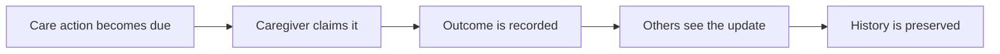
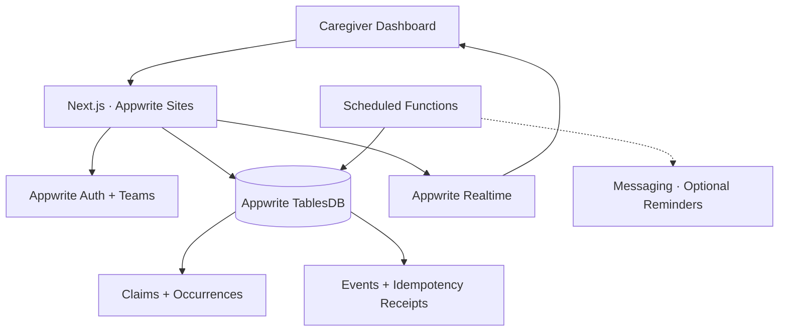

<div align="center">

### Shared care. One clear record.

**Know what's due. Know who's handling it. Know what happened.**

[](https://hackathon.appwrite.io/)


[](https://hits.dwyl.com/Omar8345/onedose)

**[🚀 Try OneDose](https://onedose.appwrite.network) · [▶ Watch the 1:51 Demo](https://cap.so/s/41tw3xw36n2g1yj)**

**Built for the [Appwrite Databases Hackathon 2026](https://hackathon.appwrite.io/)**

</div>

---

## When care is shared, who's actually responsible?

Imagine three family members helping care for someone they love.

One thinks the morning medication was handled. Another is about to give it. The third has no idea what happened.

Everyone wants to help, but their coordination lives across messages, assumptions, and memory.

That creates three important questions:

- **What needs to happen?**
- **Who's taking responsibility?**
- **What actually happened?**

That's why I built **OneDose**.

OneDose gives caregivers a shared place to coordinate schedules, claim responsibility, record outcomes, and see a clear, timestamped history of care.

Instead of wondering whether someone already handled a task, everyone can see **one authoritative record**.

## Meet OneDose

|     | Capability                   | What it does                                                                  |
| --- | ---------------------------- | ----------------------------------------------------------------------------- |
| 📅  | **Today dashboard**          | See due, upcoming, overdue, and completed care actions.                       |
| 🤝  | **Handling claims**          | Let caregivers take responsibility without duplicating work.                  |
| ✅  | **Guided outcomes**          | Record completed, skipped, refused, or unavailable actions, with notes.       |
| ⚡  | **Real-time handoffs**       | Keep caregivers updated across authenticated sessions.                        |
| 📝  | **Auditable history**        | Preserve outcomes, corrections, timestamps, and caregiver attribution.        |
| 🔁  | **Flexible schedules**       | Support daily, selected-weekday, and one-time care actions.                   |
| 👥  | **Private care circles**     | Coordinate caregivers, recipients, roles, and permissions.                    |
| 🔔  | **Reminders and escalation** | Implemented notification workflows, disabled for delivery in the hosted demo. |

### From uncertainty to one clear record



Every step is backed by real application state, not just a message saying something happened.

## See it in action

### 01 — Know what needs attention

The **Today** dashboard brings upcoming, due, overdue, and completed actions together.

Caregivers can focus on a specific recipient and understand what's next without digging through messages.

Daily routines, selected weekdays, and one-time schedules make it possible to coordinate different kinds of care.

**One shared schedule. No guessing what's next.**

### 02 — Claim responsibility without confusion

When an action becomes due, a caregiver can claim it.

Everyone else can see that someone is already handling it.

But what happens if two caregivers try to claim the same action at once?

OneDose lets the database determine one authoritative winner.

The other caregiver receives clear feedback showing **who holds the claim and when it was created**, rather than a generic error.

Claims can also be released or taken over after expiration.

**Responsibility stays visible, even when requests compete.**

### 03 — Record what actually happened

Care doesn't always go exactly as scheduled.

OneDose supports four outcomes:

| Outcome         | Meaning                                                             |
| --------------- | ------------------------------------------------------------------- |
| **Completed**   | The action was carried out.                                         |
| **Skipped**     | The action was intentionally skipped.                               |
| **Refused**     | The care recipient refused the action.                              |
| **Unavailable** | The action couldn't be completed because something was unavailable. |

Caregivers can include notes to explain the situation.

If a recorded outcome needs correcting, OneDose preserves the earlier event and adds a correction rather than silently changing history.

### 04 — Keep everyone in sync

Once a caregiver records an outcome, other connected caregivers can see the updated state through **Appwrite Realtime**.

The Handoff view shows a timestamped activity history, including who recorded each action.

A compact latest-handoff summary makes it easier for someone joining later to catch up quickly.

**Nobody should have to ask the family chat what happened three hours ago.**

### 05 — Recover when things go wrong

Real applications need to handle more than the happy path.

What if a completion succeeds, but the network response disappears?

OneDose can recognize an identical retry and return the recorded result without creating a second completion.

What if Appwrite is temporarily unreachable during a dashboard refresh?

The app keeps the last confirmed view, pauses automatic refresh, and shows a **Retry refresh** option rather than unnecessarily wiping the dashboard or signing the user out.

Confirmed session expiration and revoked access are still handled separately.

## Try the interactive demo

The hosted demo features **Mitchell Family Care**, a fictional care circle coordinating medication routines for Margaret Mitchell.

No registration, password, or email OTP is needed for the three public demo accounts.

| Demo account       | Role                      | Explore                                        |
| ------------------ | ------------------------- | ---------------------------------------------- |
| **Sarah Mitchell** | Circle owner · Daughter   | Shared schedules and care coordination         |
| **James Mitchell** | Caregiver · Son           | Claims, outcomes, and handoffs                 |
| **Emily Carter**   | Caregiver · Family friend | Availability, shared history, and live updates |

**[🚀 Open the OneDose Demo](https://onedose.appwrite.network)**

Choose one of the **Sign in as...** buttons on the login screen.

### Suggested judge walkthrough

1. Sign in as **Sarah** and explore Margaret's schedules and today's actions.
2. Open another browser profile as **James**. Claim an available action, then observe the claim from Sarah's session.
3. Record an outcome and open **Handoff** to see the updated history.
4. Sign in as **Emily** to explore the same shared care record from another caregiver's perspective.
5. Try creating a new demo schedule, recording a correction, or comparing updates across sessions.

---

## One winner. Even with 25 competing requests.

What happens when multiple caregivers attempt the same operation simultaneously?

Without coordination, conflicting actions could create uncertainty about what actually happened.

OneDose uses **Appwrite TablesDB transactions, deterministic record IDs, optimistic consistency checks, and idempotency receipts** to protect the authoritative record.

### Verified against live Appwrite

The integration tests exercise actual Appwrite database operations.

| Scenario                         |          Verified result |
| -------------------------------- | -----------------------: |
| 25 concurrent handling claims    |           **1 accepted** |
| Competing claims rejected        |                       24 |
| 25 concurrent completions        |           **1 accepted** |
| Competing completions rejected   |                       24 |
| 25 concurrent corrections        |           **1 accepted** |
| Duplicate completion events      |                    **0** |
| Identical HTTP retry             | Original result replayed |
| Changed retry payload            |        Conflict rejected |
| Revoked caregiver replay attempt |                 HTTP 403 |

**25 caregivers can compete. Only one completion becomes authoritative.**

### How OneDose keeps the record trustworthy

- **Transactions:** Related state updates, events, and receipts commit together.
- **Deterministic IDs:** Competing operations cannot silently create duplicate records under the same identity.
- **Idempotency receipts:** Repeated commands can recover their previous result.
- **Claim ownership checks:** Only the appropriate caregiver can record an outcome while a claim is active.
- **Append-only history:** Corrections preserve what was recorded before.
- **Authorization-aware retries:** Revoked caregivers cannot use old receipt keys to recover private data.

A concurrency-safe application shouldn't simply reject duplicates. It should also make the outcome understandable to the people using it.

## Powered by Appwrite

Appwrite is central to how OneDose works — from coordinating caregivers to preserving reliable shared state.

| Appwrite service | Role                                                                                            |
| ---------------- | ----------------------------------------------------------------------------------------------- |
| **TablesDB**     | Stores schedules, occurrences, claims, audit events, command receipts, and shared care records. |
| **Auth**         | Authenticates caregivers and manages their sessions.                                            |
| **Teams**        | Provides care-circle membership and role-based boundaries.                                      |
| **Realtime**     | Delivers updates to connected caregivers.                                                       |
| **Functions**    | Supports scheduled occurrence generation and reminder processing.                               |
| **Messaging**    | Supports the implemented reminder and escalation workflows.                                     |
| **Sites**        | Hosts the Next.js application.                                                                  |

### Architecture



TablesDB doesn't merely store completed forms. Its transaction and uniqueness behavior help OneDose maintain a consistent care record under concurrent requests.

Realtime then helps connected caregivers stay aligned with that authoritative state.

## Run locally

### Requirements

- Node.js 20 or newer
- An Appwrite project with TablesDB
- An appropriately scoped Appwrite server API key

**1. Clone and install**

```bash
git clone https://github.com/Omar8345/onedose.git
cd onedose
npm install
```

**2. Configure Appwrite**

```bash
cp .env.example .env.local
```

Add your own Appwrite endpoint, project, database, and server API key using the environment example.

Keep `.env.local` private. Never commit API keys.

**3. Provision the database**

```bash
npm run db:provision
```

This provisions the required application tables and validates existing structures.

Optional isolated development seed:

```bash
npm run db:seed
```

**4. Launch OneDose**

```bash
npm run dev
```

Open **http://localhost:3000**.

Ordinary installations use the existing email OTP flow. The public three-account demo is enabled separately for the configured fictional demo environment.

## Tests and verification

The repository includes integration tests for scheduling, care-circle permissions, retries, and concurrency.

```bash
npm run lint
npm run build

npm run test:schedules
npm run test:reminders
npm run test:safety
npm run test:caregivers
npm run test:recipients
npm run test:race
```

| Test              | What it covers                                                          |
| ----------------- | ----------------------------------------------------------------------- |
| `test:schedules`  | Recurrence, schedule changes, and history preservation                  |
| `test:reminders`  | Caregiver selection, availability, escalation, and duplicate prevention |
| `test:safety`     | HTTP retries, authorization, idempotency, and corrections               |
| `test:caregivers` | Invitations, revocation, and role protection                            |
| `test:recipients` | Recipient permissions and isolation                                     |
| `test:race`       | Concurrent claims, completions, and consistency                         |

Integration tests require configured Appwrite resources and appropriate API-key permissions.

`test:safety` also requires a running Next.js server at `TEST_BASE_URL`, defaulting to `http://127.0.0.1:3000`.

## Under the hood

| Layer                  | Technology                                |
| ---------------------- | ----------------------------------------- |
| Frontend               | Next.js 16, React, TypeScript, CSS        |
| Backend                | Next.js server routes and domain services |
| Database               | Appwrite TablesDB                         |
| Authentication         | Appwrite Auth + Teams                     |
| Live synchronization   | Appwrite Realtime                         |
| Background processing  | Appwrite Functions                        |
| Optional notifications | Appwrite Messaging                        |
| Deployment             | Appwrite Sites                            |
| Testing                | Node.js integration scripts               |

### 💡 Fun fact: The demo has three real caregivers

Well, fictional caregivers — but real Appwrite accounts.

Sarah, James, and Emily belong to the same seeded care circle with different roles. Their actions are stored in actual TablesDB records and synchronized between authenticated browser sessions.

The demo also contains a realistic history of completed, skipped, refused, unavailable, and corrected actions.

It's designed to let judges experience the coordination problem, not just watch a video about it.

## A note on the hosted demo

OneDose is a hackathon project demonstrating collaborative care coordination, not a certified medical application.

**Automated reminder and overdue escalation emails are disabled in the hosted version** due to deployment-plan and delivery configuration limitations. The worker implementation and related tests are included in the repository.

**OneDose must not be relied upon for emergency alerts, medical monitoring, or time-critical medication notifications.**

For deeper implementation details:

- [Product specification](docs/product.md)
- [TablesDB data model](docs/data-model.md)
- [Architecture decisions](docs/decisions.md)
- [Reminder worker](functions/reminders/README.md)

---

<div align="center">

### Care is shared. Clarity should be too.

**One shared schedule. One responsible caregiver. One clear record.**

Built with **Appwrite** for the **Appwrite Databases Hackathon 2026**.

[🚀 Live App](https://onedose.appwrite.network) · [🎬 Product Demo](https://cap.so/s/41tw3xw36n2g1yj) · [GitHub Repository](https://github.com/Omar8345/onedose)

</div>
