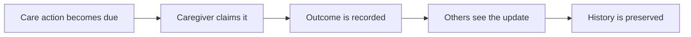
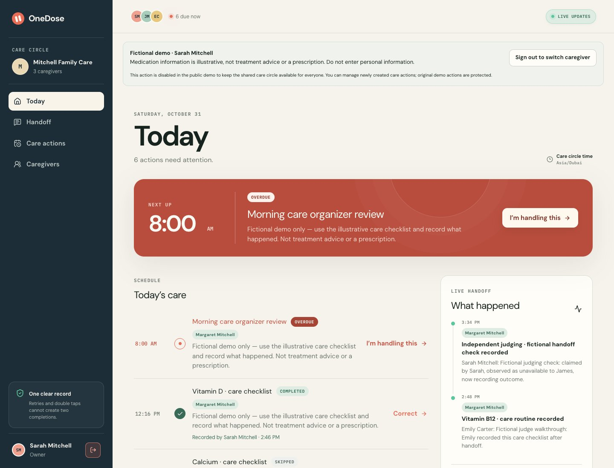
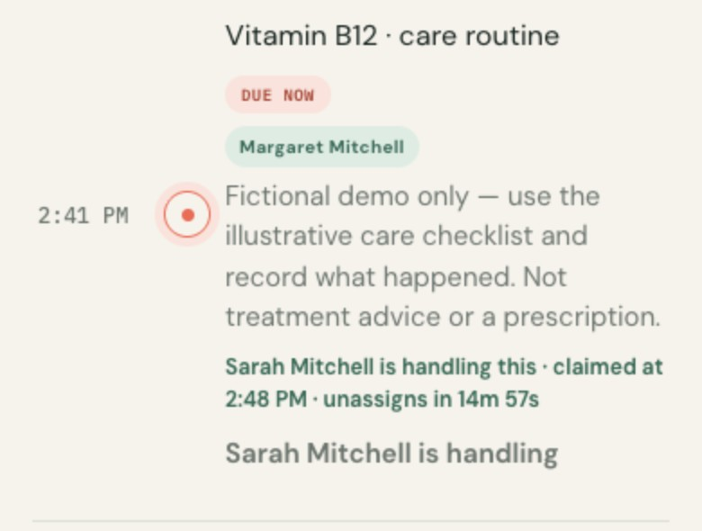
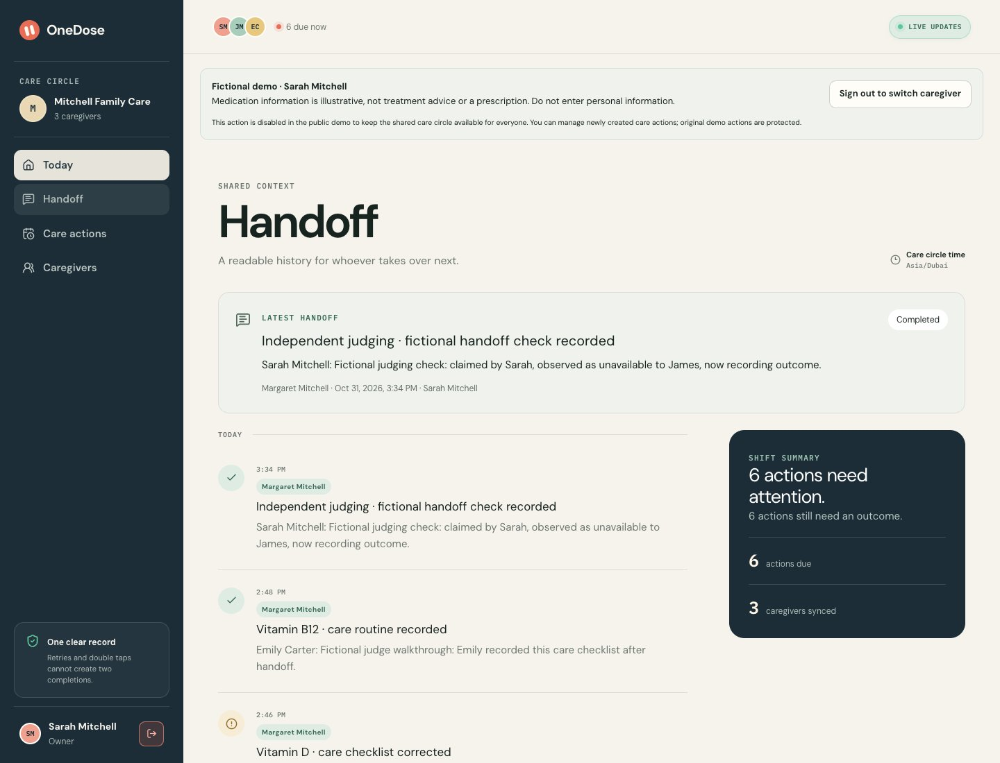
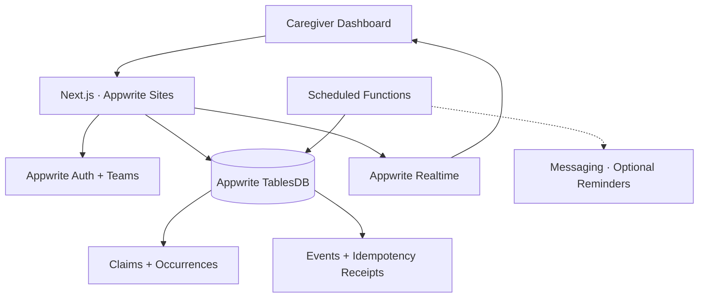

<div align="center">

### Shared care. One clear record.

**Know what's due. Know who's handling it. Know what happened.**

[](https://hackathon.appwrite.io/)    [](https://hits.dwyl.com/Omar8345/onedose)

**[🚀 Try OneDose](https://onedose.appwrite.network) · [▶ Watch the 1:51 Demo](https://cap.so/s/41tw3xw36n2g1yj) · [GitHub](https://github.com/Omar8345/onedose)**

**Built for the [Appwrite Databases Hackathon 2026](https://hackathon.appwrite.io/)**

</div>

---

## When care is shared, who's actually responsible?

Imagine three family members helping care for someone they love.

One thinks the morning medication was handled. Another is about to give it. The third has no idea what happened.

Everyone wants to help, but their coordination lives across messages, assumptions, and memory.

That creates three important questions:

- **What needs to happen?**
- **Who's taking responsibility?**
- **What actually happened?**

That's why I built **OneDose**.

OneDose gives caregivers a shared place to coordinate schedules, claim responsibility, record outcomes, and see a clear, timestamped history of care.

Instead of wondering whether someone already handled a task, everyone can see **one authoritative record**.

## Try the interactive demo

The hosted demo features **Mitchell Family Care**, a fictional care circle coordinating medication routines for Margaret Mitchell.

No registration, password, or email OTP is needed for the three public demo accounts.

| Demo account       | Role                      | Explore                                        |
| ------------------ | ------------------------- | ---------------------------------------------- |
| **Sarah Mitchell** | Circle owner · Daughter   | Shared schedules and care coordination         |
| **James Mitchell** | Caregiver · Son           | Claims, outcomes, and handoffs                 |
| **Emily Carter**   | Caregiver · Family friend | Availability, shared history, and live updates |

**[🚀 Open the OneDose Demo](https://onedose.appwrite.network)**

Choose one of the **Sign in as...** buttons on the login screen.

### Suggested judge walkthrough

1. Sign in as **Sarah** and explore Margaret's schedules and today's actions.
2. Open another browser profile as **James**. Claim an available action, then observe the claim from Sarah's session.
3. Record an outcome and open **Handoff** to see the updated history.
4. Sign in as **Emily** to explore the same shared care record from another caregiver's perspective.
5. Try creating a new demo schedule, recording a correction, or comparing updates across sessions.

## Meet OneDose

|     | Capability                   | What it does                                                                  |
| --- | ---------------------------- | ----------------------------------------------------------------------------- |
| 📅  | **Today dashboard**          | See due, upcoming, overdue, and completed care actions.                       |
| 🤝  | **Handling claims**          | Let caregivers take responsibility without duplicating work.                  |
| ✅  | **Guided outcomes**          | Record completed, skipped, refused, or unavailable actions, with notes.       |
| ⚡  | **Real-time handoffs**       | Keep caregivers updated across authenticated sessions.                        |
| 📝  | **Auditable history**        | Preserve outcomes, corrections, timestamps, and caregiver attribution.        |
| 🔁  | **Flexible schedules**       | Support daily, selected-weekday, and one-time care actions.                   |
| 👥  | **Private care circles**     | Coordinate caregivers, recipients, roles, and permissions.                    |
| 🔔  | **Reminders and escalation** | Implemented notification workflows, disabled for delivery in the hosted demo. |

### From uncertainty to one clear record



Every step is backed by real application state, not just a message saying something happened.

## See it in action

### 01 — Know what needs attention

The **Today** dashboard brings upcoming, due, overdue, and completed actions together. Filter by recipient and see the care circle’s local time without digging through messages.



### 02 — Claim responsibility without confusion

When an action becomes due, a caregiver can claim it. If requests compete, the database determines one authoritative winner. Other authorized caregivers see **who holds the claim and when it was created**, rather than a generic error. Claims can be released or taken over after expiration.

<p align="center">
  
</p>
<p align="center">
  <sub>When a claim conflicts, caregivers see who is responsible and when the claim was made.</sub>
</p>

### 03 — Record what happened and hand over clearly

Record **completed, skipped, refused, or unavailable** outcomes with notes. Corrections append a new event instead of silently changing history.

Appwrite Realtime keeps connected caregivers updated. The **latest-handoff summary** and timestamped history show what happened, who recorded it, and the relevant status.



### 04 — Recover when things go wrong

An identical retry returns the recorded result without creating another completion. If Appwrite is temporarily unreachable during refresh, OneDose keeps the last confirmed view, pauses automatic refresh, and offers **Retry refresh**. Confirmed session expiration and revoked access are handled separately.

## One winner. Even with 25 competing requests.

OneDose uses **Appwrite TablesDB transactions, deterministic record IDs, optimistic consistency checks, and idempotency receipts** to protect the authoritative record.

The integration tests exercise actual Appwrite database operations.

| Scenario                         |          Verified result |
| -------------------------------- | -----------------------: |
| 25 concurrent handling claims    |           **1 accepted** |
| Competing claims rejected        |                       24 |
| 25 concurrent completions        |           **1 accepted** |
| Competing completions rejected   |                       24 |
| 25 concurrent corrections        |           **1 accepted** |
| Duplicate completion events      |                    **0** |
| Identical HTTP retry             | Original result replayed |
| Changed retry payload            |        Conflict rejected |
| Revoked caregiver replay attempt |                 HTTP 403 |

**25 competing requests. One authoritative completion. Zero duplicates.**

**Realtime independently verified:** Two authenticated browser sessions received claim, release, takeover, completion, and correction updates through Appwrite Realtime without page reloads. Observed update delays were **4.6–7.8 seconds** during testing, not a guaranteed synchronization time.

### How OneDose keeps the record trustworthy

- **Transactions:** Related state updates, events, and receipts commit together.
- **Deterministic IDs:** Competing operations cannot silently create duplicate records under the same identity.
- **Idempotency receipts:** Repeated commands can recover their previous result.
- **Claim ownership checks:** Only the appropriate caregiver can record an outcome while a claim is active.
- **Append-only history:** Corrections preserve what was recorded before.
- **Authorization-aware retries:** Revoked caregivers cannot use old receipt keys to recover private data.

## Powered by Appwrite

The application uses **Next.js 16, React, TypeScript, and CSS**, with server routes and domain services coordinating Appwrite operations.

| Appwrite service | Role                                                                                            |
| ---------------- | ----------------------------------------------------------------------------------------------- |
| **TablesDB**     | Stores schedules, occurrences, claims, audit events, command receipts, and shared care records. |
| **Auth**         | Authenticates caregivers and manages their sessions.                                            |
| **Teams**        | Provides care-circle membership and role-based boundaries.                                      |
| **Realtime**     | Delivers updates to connected caregivers.                                                       |
| **Functions**    | Supports scheduled occurrence generation and reminder processing.                               |
| **Messaging**    | Supports the implemented reminder and escalation workflows.                                     |
| **Sites**        | Hosts the Next.js application.                                                                  |

### Architecture



TablesDB transactions and deterministic IDs protect related writes; Realtime helps connected caregivers converge on that authoritative state.

## Run locally

Requires **Node.js 20+**, an Appwrite project with TablesDB, and an appropriately scoped server API key.

```bash
git clone https://github.com/Omar8345/onedose.git
cd onedose
npm install
cp .env.example .env.local
```

Configure your own endpoint, project, database, and server API key in `.env.local`; keep it private. Provision your own development project, then start the app:

```bash
npm run db:provision
npm run dev
```

Open **http://localhost:3000**. Ordinary installations use email OTP; the three-account demo is enabled separately for the configured fictional environment. The hosted demo is already provisioned and needs no setup.

## Tests and verification

```bash
npm run lint
npx tsc --noEmit
npm run build

npm run test:schedules
npm run test:reminders
npm run test:safety
npm run test:caregivers
npm run test:recipients
npm run test:race
npm run test:demo
npm run test:snapshot
npm run test:demo-protection
```

| Test                   | What it covers                                                          |
| ---------------------- | ----------------------------------------------------------------------- |
| `test:schedules`       | Recurrence, schedule changes, and history preservation                  |
| `test:reminders`       | Caregiver selection, availability, escalation, and duplicate prevention |
| `test:safety`          | HTTP retries, authorization, idempotency, and corrections               |
| `test:caregivers`      | Invitations, revocation, and role protection                            |
| `test:recipients`      | Recipient permissions and isolation                                     |
| `test:race`            | Concurrent claims, completions, and consistency                         |
| `test:demo`            | Demo login allowlist, origin checks, roles, and rate window             |
| `test:snapshot`        | Transport failures, access denial, and refresh recovery                 |
| `test:demo-protection` | Scoped OTP restrictions and schedule-management policy                  |

Integration tests require configured Appwrite resources and appropriate API-key permissions. `test:safety` also needs a running Next.js server at `TEST_BASE_URL` (default `http://127.0.0.1:3000`). Run the suites serially for clear service-dependent evidence.

On **31 October 2026, all 9 integration test suites passed** in a complete serial run against the configured Appwrite environment.

Schedule and recipient suites create uniquely named synthetic users, a Team, circle, and recipients, then clean up their own resources. They do not require the legacy Nora seed or modify Mitchell Family Care.

The race suite verifies database contention and snapshot convergence separately from browser Realtime behavior.

A two-browser Realtime verification also passed: WebSocket events preceded snapshot requests and visible updates for claims, releases, takeovers, completions, and corrections, without page reloads. Observed update delays ranged from **4.6 to 7.8 seconds**.

The reproducible steps are documented in the [two-session Realtime verification guide](docs/realtime-verification.md).

## Hosted demo limitations

The three fictional caregivers are **real, shared Appwrite accounts**, with actual TablesDB records and live synchronization. Do not enter personal information. Application guards protect seeded schedules and circle administration; shared-account access is not complete isolation. Direct Appwrite Team/account permissions remain an accepted hackathon limitation.

All three caregivers can create demo schedules and manage those new schedules; original seeded schedules remain protected through the application. Sarah remains the actual circle owner.

**Automated reminder and overdue escalation emails are disabled in the hosted version** because of deployment-plan and delivery configuration limitations. Worker implementations and tests are included; the demo makes no artificial delivered-notification claims.

OneDose demonstrates care coordination. It does not diagnose, prescribe, or recommend treatment, and is not a certified medical application. **Do not rely on it for emergency alerts, medical monitoring, or time-critical medication notifications.**

### Technical documentation

- [Product specification](docs/product.md)
- [TablesDB data model](docs/data-model.md)
- [Architecture decisions](docs/decisions.md)
- [Reminder worker](functions/reminders/README.md)
- [Two-session Realtime verification](docs/realtime-verification.md)

---

<div align="center">

### Care is shared. Clarity should be too.

**Shared care. One clear record.**

[🚀 Live App](https://onedose.appwrite.network) · [🎬 Product Demo](https://cap.so/s/41tw3xw36n2g1yj) · [GitHub Repository](https://github.com/Omar8345/onedose)

</div>
