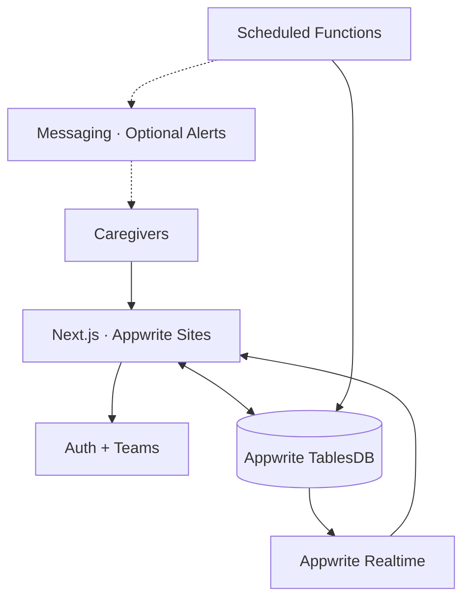

# OneDose

**Shared care. One clear record.**


### 🎬 Product Demo

**[▶ Watch the OneDose Demo (1:51)](https://cap.so/s/41tw3xw36n2g1yj)**

A 1-minute, 51-second walkthrough of OneDose's shared care coordination, handling claims, and real-time handoffs.

When care is shared across a family, messages and memory aren't enough.

Did someone handle the medication? Who's taking care of the next task? Was an action completed, skipped, or simply forgotten?

**OneDose replaces uncertainty with a shared, real-time record of care.**

Caregivers can coordinate recurring tasks, claim responsibility, record outcomes, and follow a clear history of what happened — all inside a private care circle.

**[🚀 Live App](https://onedose.appwrite.network)** · **[🎬 Watch Demo](https://cap.so/s/41tw3xw36n2g1yj)** · **[Source Code](https://github.com/Omar8345/onedose)**

Built for the **2026 Appwrite Databases Hackathon**.

> **Live demo note:** Automated email reminders and overdue alerts are disabled in the hosted demo due to Appwrite plan limitations. The notification functionality is implemented in the source code and can be enabled with the appropriate plan and email provider configuration. Core care-coordination features remain available.

---

## What OneDose does

OneDose brings everyday care coordination into a single shared workflow.

| Feature                  | How it works                                                                                                                                     |
| ------------------------ | ------------------------------------------------------------------------------------------------------------------------------------------------ |
| **Today dashboard**      | View due, upcoming, and overdue actions for each care recipient.                                                                                 |
| **Handling claims**      | Claim responsibility so other caregivers know an action is being handled.                                                                        |
| **Guided outcomes**      | Record completed, skipped, refused, or unavailable actions, with optional notes.                                                                 |
| **Live handoffs**        | See updates across caregiver sessions without refreshing.                                                                                        |
| **Flexible schedules**   | Create daily, weekly, selected-weekday, or one-time actions with time-zone awareness.                                                            |
| **Private care circles** | Invite trusted caregivers, manage roles, and coordinate multiple recipients.                                                                     |
| **Preserved history**    | Review past actions and corrections without silently overwriting earlier records.                                                                |
| **Smart reminders**      | An implemented notification workflow that prioritizes available caregivers and escalates overdue actions. Currently inactive in the hosted demo. |

### Designed around accountability

Each care action follows a simple sequence:

1. **Due** — An action appears on the shared schedule.
2. **Claimed** — A caregiver takes responsibility.
3. **Recorded** — The caregiver submits an outcome.
4. **Synchronized** — Other caregivers see the updated state.
5. **Preserved** — The outcome becomes part of an auditable history.

The result is a shared record that answers three essential questions:

**What needs to happen? Who is handling it? What actually happened?**

---

## Built on Appwrite

Appwrite powers OneDose's authentication, data persistence, permissions, synchronization, background processing, and deployment.

| Service       | Role                                                                                                                    |
| ------------- | ----------------------------------------------------------------------------------------------------------------------- |
| **TablesDB**  | Stores care circles, recipients, schedules, occurrences, handling leases, outcomes, audit events, and command receipts. |
| **Auth**      | Provides passwordless Email OTP authentication.                                                                         |
| **Teams**     | Manages private care-circle membership, invitations, roles, and access revocation.                                      |
| **Realtime**  | Synchronizes care updates across authenticated sessions.                                                                |
| **Functions** | Supports scheduled occurrence generation and reminder processing.                                                       |
| **Messaging** | Implements notification delivery and escalation workflows, currently inactive in the hosted demo.                       |
| **Sites**     | Hosts the Next.js application.                                                                                          |

### Architecture



Appwrite isn't merely used to store data. Its database and permission model support the consistency and access controls behind the entire product.

---

## One completion. Even under contention.

What happens when two caregivers try to complete the same action simultaneously?

OneDose is designed to accept **one authoritative completion**, reject conflicting writes, and keep every authenticated caregiver's view consistent.

The repository includes an integration race test against live Appwrite TablesDB infrastructure.

### Verified concurrency test

25 concurrent handling claims and 25 concurrent completion requests were executed against the same logical care action.

| Verification                     |     Result |
| -------------------------------- | ---------: |
| Handling claims accepted         | **1 / 25** |
| Competing claims rejected        |    24 / 25 |
| Completions accepted             | **1 / 25** |
| Conflicting completions rejected |    24 / 25 |
| Audit events created             |          1 |
| Command receipts created         |          1 |
| Authenticated views converged    |        Yes |

**50 competing requests. Two successful writes across the two phases. No duplicate completion.**

### How it works

OneDose combines:

- **Handling leases** to coordinate temporary responsibility.
- **Optimistic version checks** to detect conflicting updates.
- **Idempotency receipts** to prevent duplicate command processing.
- **Append-only audit events** to preserve recorded history.
- **Realtime synchronization** to propagate authoritative state to connected caregivers.

Retries can return the previously recorded result without creating a second completion.

---

## Hosted demo and feature availability

The hosted version focuses on the core coordination experience: private care circles, schedules, handling claims, recorded outcomes, history, and live synchronization.

**Automated email reminders and overdue escalation are currently disabled in the hosted demo due to Appwrite plan limitations.**

The reminder and escalation implementation remains in the repository, along with integration tests for caregiver selection, availability fallback, overdue escalation, and duplicate-delivery prevention.

These notification features require separate delivery configuration and can be re-enabled in a suitable deployment.

Passwordless authentication remains available through Appwrite's built-in email delivery service.

OneDose is a coordination and record-keeping application, not a medical monitoring service. It should not be relied upon for emergency alerts or time-critical medical notifications.

---

## Run locally

### Requirements

- Node.js 20 or newer
- An Appwrite project with TablesDB enabled
- An Appwrite API key with the necessary permissions

### 1. Clone the repository

```bash
git clone https://github.com/Omar8345/onedose.git
cd onedose
npm install
```

### 2. Configure the environment

```bash
cp .env.example .env.local
```

The example environment documents the public endpoint, project ID, and database ID.

Add your own server API key to `.env.local`.

Required permissions include:

- TablesDB schema, read, and write access
- `sessions.read`, `sessions.write`
- `users.read`, `users.write`
- `teams.read`, `teams.write`

**Never commit API keys or other secrets to version control.**

### 3. Provision TablesDB

```bash
npm run db:provision
```

Provisioning is idempotent: it creates missing tables, validates existing structures, and stops when it detects an incompatible or incomplete schema.

Optional synthetic development data:

```bash
npm run db:seed
```

Seed data is isolated from authenticated production care circles.

### 4. Start the development server

```bash
npm run dev
```

Visit **http://localhost:3000**.

---

## Tests and verification

OneDose includes integration tests covering its scheduling, access-control, notification, and concurrency behavior.

```bash
npm run lint
npm run build
npm run test:schedules
npm run test:reminders
npm run test:safety
npm run test:caregivers
npm run test:recipients
npm run test:race
```

| Test              | Coverage                                                                                           |
| ----------------- | -------------------------------------------------------------------------------------------------- |
| `test:schedules`  | Recurrence, schedule changes, pause/resume, removal permissions, and history preservation.         |
| `test:reminders`  | Caregiver selection, availability fallback, overdue escalation, and duplicate-delivery protection. |
| `test:safety`     | Membership authorization, idempotent retries, concurrent corrections, and stale-write rejection.   |
| `test:caregivers` | Membership revocation, invitation cancellation, owner protection, and access removal.              |
| `test:recipients` | Profile permissions, bulk assignment, recipient isolation, and archival.                           |
| `test:race`       | Concurrent claims and completion requests with a single accepted winner per phase.                 |

Integration tests interact with real Appwrite services and clean up their temporary test records.

`test:safety` requires a running Next.js server (`npm run dev`) at
`TEST_BASE_URL` (default `http://127.0.0.1:3000`). Both processes must use the
same Appwrite endpoint, project, database, and server API key configuration.
The provisioned tables and indexes must exist; the API key needs TablesDB,
Users/session, and Teams/membership access. The test creates its own synthetic
user, team, circle, membership, and occurrence; it does not use demo accounts.
It checks configuration and the unauthenticated completion route before creating
fixtures. HTTP requests time out after 15 seconds. Cleanup attempts all tracked
resources, including claims and sessions, and reports failures.

Completion receipts created before commit `352e1dd` used a fingerprint containing
`occurredAt`. Retrying those keys returns a conflict even for otherwise identical
input. Existing receipts are not migrated or accepted with weakened comparisons.
Current receipts ignore the server-generated timestamp while retaining semantic
conflict detection. Replay requires current active recording membership; revoked
caregivers receive no replay data.

To retain race-test data for inspection:

```bash
KEEP_RACE_DATA=1 npm run test:race
```

---

## Scheduled automation and reminders

The automation worker is located in [`functions/reminders`](functions/reminders).

Its implementation supports:

1. Generating scheduled occurrences.
2. Finding due and overdue actions.
3. Selecting the first available caregiver.
4. Delivering an initial reminder.
5. Escalating unresolved actions to other available caregivers.
6. Preventing repeated deliveries through durable notification records.

The hosted demo does not currently send automated reminder or escalation emails.

### Optional deployment

To enable the complete worker in your own Appwrite project:

| Setting        | Value                                                     |
| -------------- | --------------------------------------------------------- |
| Root directory | `functions/reminders`                                     |
| Entrypoint     | `src/main.js`                                             |
| Build command  | `npm install`                                             |
| Schedule       | Every 60 minutes                                          |
| Scopes         | `rows.read`, `rows.write`, `messages.write`, `teams.read` |

Configure an Appwrite Messaging email provider before enabling real email delivery.

Keep delivery in dry-run mode until provider configuration and recipient routing have been verified.

See [`functions/reminders/README.md`](functions/reminders/README.md) for the full setup.

---

## Technical documentation

For a closer look at the system:

- **[Product specification](docs/product.md)** — User journeys, safety invariants, application boundaries, and edge cases.
- **[Data model](docs/data-model.md)** — TablesDB schema, indexes, permissions, occurrence generation, and concurrency handling.
- **[Architecture decisions](docs/decisions.md)** — Tradeoffs behind concurrency, auditing, access control, Realtime, reminders, and archival.

---

## Why OneDose?

Shared care depends on more than remembering a schedule.

It depends on knowing whether someone has taken responsibility, whether the action actually happened, and whether everyone is looking at the same information.

**OneDose turns scattered coordination into one clear, traceable handoff.**

Built with **Next.js and Appwrite** for the **2026 Appwrite Databases Hackathon**.

**[🚀 Launch OneDose](https://onedose.appwrite.network)** · **[🎬 Watch Demo (1:51)](https://cap.so/s/41tw3xw36n2g1yj)**

Claim responses refresh current TablesDB claim and occurrence state with active circle
and Team membership checks. Losing caregivers see the current holder and claim time;
released or expired leases appear available. The handoff view summarizes the latest
filtered audit event above history using existing data and the selected timezone.

## Judge-ready fictional demo (opt-in; not enabled by default)

The Mitchell dataset uses a dedicated demo project. The named account buttons
appear when this version is deployed with demo mode enabled. All identities and
medication information are fictional;
this is not treatment advice or a prescription. Do not enter personal information.

| Account | Email | Access |
|---|---|---|
| Sarah Mitchell | sarah.mitchell@example.com | Daughter; circle owner |
| James Mitchell | james.mitchell@example.com | Son; caregiver |
| Emily Carter | emily.carter@example.com | Family friend; caregiver |

Once enabled, choose a named demo button on the sign-in screen. No email message,
password, or fixed OTP is needed. Sign out before choosing another caregiver; use
separate browser profiles to compare two caregivers. These are public shared
accounts, so other judges can change the same records.

Suggested walkthrough:

1. Choose Sarah and open Margaret's fictional care profile and schedules. Compare
   daily routines, selected weekdays, and a one-time task.
2. Choose James in another browser. Inspect his current handling claim, including
   its timestamp. Claim an available due task, then try the same task from a stale
   Sarah page to see authoritative conflict feedback.
3. Record an outcome with a short fictional note. Open Handoff to see the latest
   summary, caregiver attribution, and timestamped history, including a correction.
4. Choose Emily to see shared history and her different availability. Compare her
   caregiver role with Sarah's owner role; public demo administration is restricted.
5. Check updates across both sessions. Appwrite Auth provides real sessions; Teams
   and row permissions restrict access; TablesDB transactions, deterministic IDs,
   receipts, and append-only events protect mutations; Realtime propagates changes.
   No delivered notifications or unsupported release-audit records are fabricated.

### Demo authentication boundaries

Set server-only `ONEDOSE_DEMO_ENABLED=true` and `ONEDOSE_DEMO_ORIGIN` to the exact
approved origin (`https://onedose.appwrite.network`, or localhost/127.0.0.1 port
3000 for local verification). Endpoint, project, and database must match the pinned
OneDose demo target. The server accepts only the three fixed selections, validates
exact Auth emails, active circle roles, preferences, and confirmed Team memberships,
and sets the existing HttpOnly session cookie. A bounded in-memory limiter permits
30 attempts per server process per minute. It needs no external service; budgets
reset on restart and are separate across instances, so this is best-effort abuse
protection, not a distributed security boundary. The identity allowlist remains
the security boundary.
Origin checks reject cross-site login requests. The code never accepts arbitrary
emails/user IDs for administrative session creation. Normal email OTP remains available for ordinary users; the three verified demo
identities must use the named buttons.
`123456` has no special authentication meaning. Public demo sessions have extra server-enforced administration restrictions,
including Sarah's owner session. Sarah remains the actual circle owner.
Keep real accounts and real medical information out of this project.

### Local demo administration

Reset, seed, dataset generation, backups, and approval manifests remain local-only
and Git-ignored. They are not deployed or required by the application. Only the
runtime authentication code and public authentication tests belong in the repository.
A fresh, exact reset manifest must be reviewed and explicitly approved before any
deletion. Infrastructure and schemas must be preserved. Dates use Asia/Dubai and
manual refresh; never reset while judges are interacting.

### Connection recovery

Background refreshes request a fresh, authorized snapshot. A timeout or service
failure keeps the last confirmed dashboard with a Retry refresh message and pauses
the refresh timer until a successful retry. Requests are deduplicated and have a
15-second client timeout. Confirmed session expiry or revoked access removes the
private view and rechecks access; network errors never clear the session cookie.

### Public demo safeguards

All three demo caregivers may create care actions and edit/archive actions created
through the public demo. These receive server-generated `public_demo_` IDs; clients
cannot choose IDs. Original seeded actions and their occurrences cannot be changed
through schedule management. Normal outcome recording and append-only corrections
remain interactive. Other circles retain owner-only schedule management.

Demo circle invitations, membership changes, recipient changes, escalation settings,
and profile changes are blocked by server-side guards. Original-action editing and
administration controls are disabled/hidden with a public-demo explanation.

### Accepted shared-account security limitations

This hackathon deployment intentionally retains the tested Appwrite authentication
and Realtime architecture. The three fictional accounts are public and shared;
all visitors using one account act as the same Appwrite user. Do not use this
configuration for real care, personal information, or private production accounts.

Application guards do not override Appwrite's own Team/account permissions. Sarah
retains the Appwrite Team owner role; members can also leave their own membership.
A visitor using Appwrite directly may bypass OneDose's administrative restrictions.
Read-only database row permissions still prevent direct row writes, but do not
remove these separate Team/account capabilities.

The Realtime endpoint returns a reusable, session-backed Appwrite JWT to the
browser. It carries the user's Appwrite permissions, not a Realtime-only scope.
Responses use `Cache-Control: private, no-store`; that prevents caching, not reuse
by the authenticated recipient. JWT lifetime and renewal behavior are unchanged.

The HttpOnly `onedose_session` cookie contains the underlying Appwrite session
secret. HttpOnly prevents page JavaScript from reading it, not a person controlling
the browser from inspecting and reusing it. Removing JWT responses, shortening
token lifetime, hiding controls, or changing Team roles alone would not eliminate
all equivalent-credential or self-removal risks. Normal logout revokes the current
Appwrite session and clears its cookie; the current implementation suppresses
revocation errors, so an outage can leave revocation unconfirmed.

These residual risks are explicitly accepted for the dedicated fictional hackathon
demo. No Realtime bridge, opaque application-session system, or Team-role changes
are part of this release. Strict isolation would require a separately reviewed
credential/session and Realtime design; a bridge alone would not solve exposure
of the underlying session cookie. Existing server guards remain in force.
