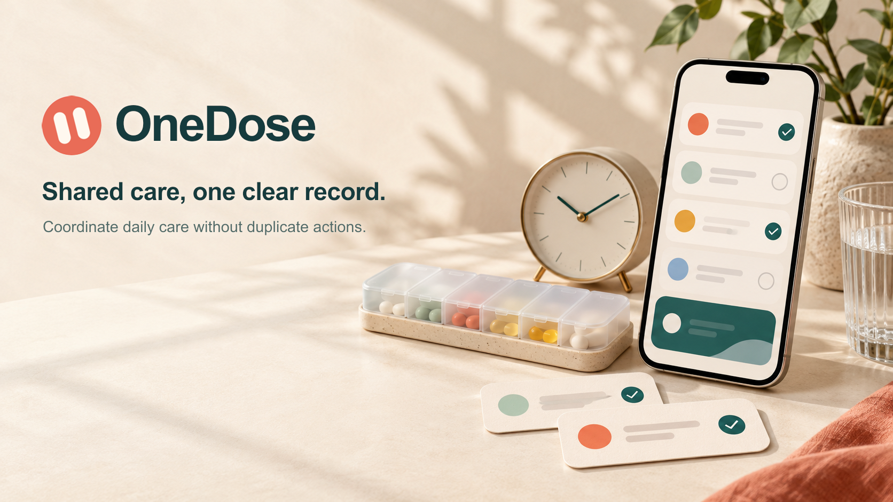
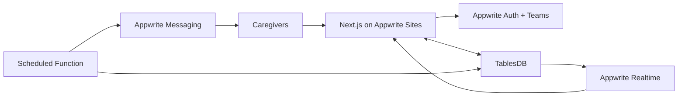

# OneDose



When care is shared across a family, messages and memory are not enough. OneDose
turns recurring care tasks into one live handoff: everyone can see what is due,
who is handling it, and what already happened.

Every action can be claimed, recorded once, corrected without erasing history,
and synchronized across the entire care circle in real time.

**Live app:** [onedose.appwrite.network](https://onedose.appwrite.network)

Built for the **2026 Appwrite Databases Hackathon**.

## The product

OneDose is designed around the moments where shared care usually becomes
unclear:

- **Today** brings due, upcoming, and overdue actions into one recipient-aware view.
- **Handling claims** show who is taking responsibility before the action is recorded.
- **Guided outcomes** capture completed, skipped, refused, and unavailable states with handoff notes.
- **Live handoff** gives the next caregiver a readable, append-only history.
- **Flexible schedules** support daily, selected-weekday, and one-time actions across time zones.
- **Care circles** provide private invitations, roles, availability, and recipient profiles.
- **Smart reminders** contact one available caregiver first, then escalate only when an action remains overdue.
- **Corrections** preserve the original event instead of silently rewriting history.

Real users can sign in without a password, create a private care circle, invite
caregivers, and start coordinating immediately. The included seed data is only
for repeatable development and verification.

## Why Appwrite

Appwrite is not an add-on to OneDose; it provides the product's identity,
coordination, persistence, automation, and deployment layers.

| Appwrite service | What it does in OneDose |
| --- | --- |
| **TablesDB** | Stores circles, recipients, schedules, occurrences, handling leases, outcomes, audit events, command receipts, and notification deliveries. |
| **Auth** | Provides passwordless Email OTP sign-in and authenticated sessions. |
| **Teams** | Isolates each care circle and powers invitations, roles, and membership revocation. |
| **Realtime** | Synchronizes care updates across authenticated caregiver sessions without manual refreshes. |
| **Functions** | Generates scheduled occurrences and performs hourly reminder and escalation sweeps. |
| **Messaging** | Sends Email OTP, invitations, due reminders, and overdue alerts. |
| **Sites** | Hosts the server-rendered Next.js application at the live production URL. |



## One completion, even under contention

The core promise is stronger than hiding a duplicate button press. When two
authorized caregivers act on the same due item concurrently, OneDose must accept
exactly one completion and make every other attempt converge on that winner.

The repository includes a live race test against TablesDB. Its latest verified
run launched 25 handling claims and 25 completion requests simultaneously:

| Proof | Result |
| --- | ---: |
| Handling claims accepted | **1 of 25** |
| Competing claims blocked | **24 of 25** |
| Completions accepted | **1 of 25** |
| Conflicting completions rejected | **24 of 25** |
| Audit events created | **1** |
| Command receipts created | **1** |
| Authenticated views converged | **Yes** |

The protection combines a short handling lease, optimistic occurrence versions,
idempotency receipts, and append-only audit events. Retries can safely return the
recorded winner without producing another completion.

## Run locally

### 1. Install and configure

Use Node.js 20 or newer and an Appwrite project with TablesDB enabled.

```bash
git clone https://github.com/Omar8345/onedose.git
cd onedose
npm install
cp .env.example .env.local
```

The public endpoint, project ID, and database ID are already documented in
`.env.example`. Add your own server API key to `.env.local`; never commit it.
The key needs TablesDB schema/read/write permissions plus `sessions.read`,
`sessions.write`, `users.read`, `users.write`, `teams.read`, and `teams.write`.

### 2. Provision the database

```bash
npm run db:provision
```

Provisioning is idempotent. It creates missing tables and verifies existing
ones, stopping if it finds an incomplete or incompatible schema.

Optional synthetic data can be added with:

```bash
npm run db:seed
```

The seed creates a deterministic, isolated care circle for development and test
scripts. It does not appear inside authenticated user circles.

### 3. Start OneDose

```bash
npm run dev
```

Open [http://localhost:3000](http://localhost:3000).

## Verify the system

These scripts exercise the real Appwrite-backed services and remove their
temporary records afterward:

```bash
npm run lint
npm run build
npm run test:schedules
npm run test:reminders
npm run test:safety
npm run test:caregivers
npm run test:recipients
npm run test:race
```

| Script | What it proves |
| --- | --- |
| `test:schedules` | Recurrence, editing, pause/resume, removal authorization, and preserved history. |
| `test:reminders` | First-contact routing, availability fallback, overdue escalation, and duplicate-delivery prevention. |
| `test:safety` | Membership authorization, idempotent retries, concurrent corrections, and stale-write rejection. |
| `test:caregivers` | Team revocation, owner protection, invitation cancellation, and immediate access removal. |
| `test:recipients` | Owner-only profile changes, bulk assignment, independent schedules, and safe archival. |
| `test:race` | One winner under 25 simultaneous claims and completion requests. |

Set `KEEP_RACE_DATA=1` if you want to inspect the race-test rows before cleanup.

## Reminder function

The production worker lives in [`functions/reminders`](functions/reminders). It
runs hourly to create missing occurrences, notify the first available caregiver,
and escalate overdue actions to the remaining available circle members.
`notification_deliveries` makes repeated function executions safe.

Deploy it as an Appwrite Function with:

- root directory: `functions/reminders`
- entrypoint: `src/main.js`
- build command: `npm install`
- schedule: every 60 minutes
- scopes: `rows.read`, `rows.write`, `messages.write`, and `teams.read`

Configure an Appwrite email provider before disabling dry-run mode. The complete
function setup is documented in
[`functions/reminders/README.md`](functions/reminders/README.md).

## Architecture and product contract

- [`docs/product.md`](docs/product.md) defines the user flows, safety invariants, boundaries, and edge cases.
- [`docs/data-model.md`](docs/data-model.md) documents every TablesDB table, index, permission, reminder sweep, and completion transaction.
- [`docs/decisions.md`](docs/decisions.md) records the technical decisions behind concurrency, history, access, Realtime, reminders, and archival.

OneDose is a coordination and record-keeping tool. Its schedules, occurrences,
outcomes, people, and notifications are intentionally explicit so that every
visible state can be traced back to durable Appwrite data.
